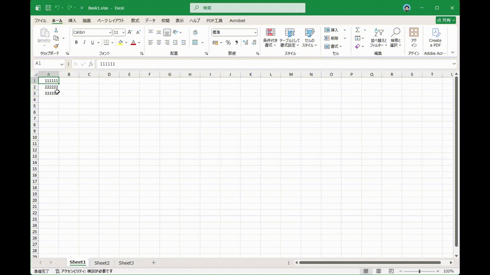

# BackToA1

<div align="center" markdown="1">

[日本語](README.md) | 简体中文

共享Excel文件时，也要确保文件易于阅读。

只需关闭工作簿，各工作表中选中的单元格就会自动恢复为A1。

[](https://github.com/boris1993/BackToA1)
[](https://dotnet.microsoft.com/)
[](https://www.microsoft.com/microsoft-365)
[](LICENSE.txt)


<a href="https://www.buymeacoffee.com/boris1993" target="_blank"></a>

</div>

---

## 功能演示



## 系统要求

- Windows 7或更高版本
- Microsoft Office 2013或更高版本
- .NET Framework 4.7.2或更高版本

## 安装

- 从[Releases](https://github.com/boris1993/BackToA1/releases/latest)下载最新版本
- 将ZIP的内容解压缩到合适的地方
- 因为代码签名证书是我自己生成的自签名证书，所以需要通过如下步骤安装并信任
    - 打开解压得到的目录并在其中启动PowerShell，执行如下命令以校验`BackToA1_Signing.cer`证书的指纹是否为`B68CBB359417EAB50C2133E9D6AB51277267D7A5`
    
    ```powershell
    $cert = [System.Security.Cryptography.X509Certificates.X509Certificate2]::new(
        (Resolve-Path ".\BackToA1_Signing.cer")
    )

    $cert.Thumbprint
    ```
    
    - 将输出与上面的指纹比对（大小写和空格可以忽略），如果指纹不一致请勿安装
    - 如果`install-and-trust-code-signing-cert.ps1`被阻止运行，那么执行以下命令解除文件阻止状态
    
    ```powershell
    Unblock-File -LiteralPath .\install-and-trust-code-signing-cert.ps1
    ```
    
    - 在相同PowerShell窗口中运行`.\install-and-trust-code-signing-cert.ps1`脚本，根据提示完成证书的安装
- 运行`setup.exe`安装插件

## 卸载

在Windows设置中打开“安装的应用”，找到BackToA1，点击卸载即可

## 编译

- 安装Visual Studio 2026及Microsoft 365 development开发套件
- 克隆本仓库
- 在Visual Studio 2026中打开本项目的解决方案文件`BackToA1.slnx`

## 许可证

本项目根据MIT许可证开放源代码，许可证原文见[LICENSE](LICENSE.txt)
